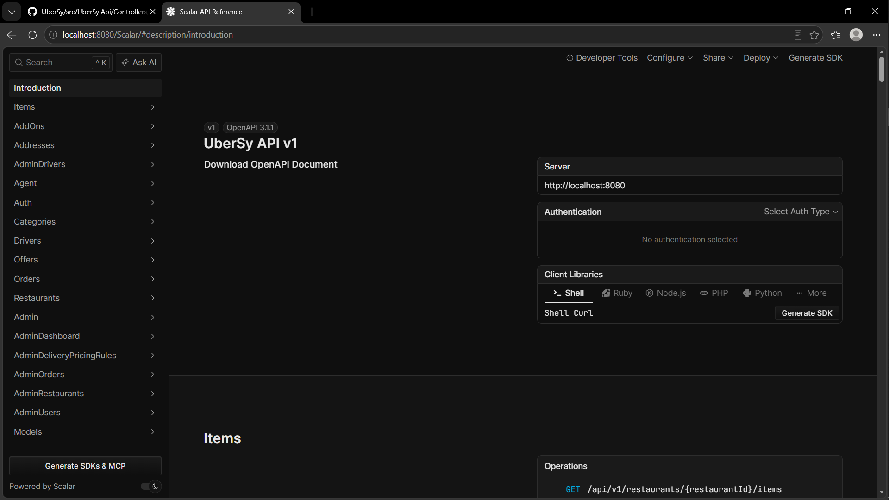
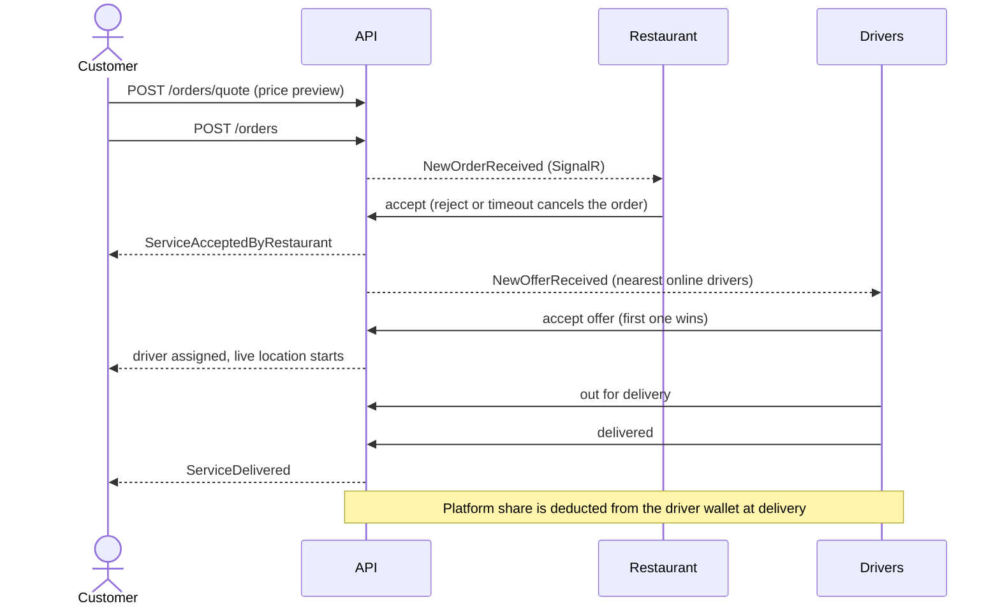

# UberSy

A multi-service delivery platform for Syria, built with ASP.NET Core and Clean Architecture.

**Status:** food delivery is complete end to end (customer, restaurant, driver, admin and agent). Ride/package delivery and table reservation are planned and are not implemented yet.



## Why this project

Services like Uber are not available in Syria, and online payment gateways are not an option locally. UberSy is designed around that reality: orders are **cash on delivery**, and drivers keep a **prepaid wallet** that covers the platform's share of each order.

## Status

| Service | State |
|---|---|
| Food delivery | Complete |
| Person / package delivery | Planned (data model anticipates it) |
| Table reservation | Planned |

## What food delivery covers

- **Customer**: sign up with email/SMS confirmation, manage addresses, browse and search restaurants, preview the full price before ordering, place an order, follow it live (status changes and driver location over SignalR), order history.
- **Restaurant owner**: register a restaurant (admin approval grants the owner role), manage profile, opening hours, menu, add-ons and order limits, receive new orders in real time, accept or reject within a time limit, daily statistics. Restaurants never see the customer's address or the driver's details.
- **Driver**: register (admin approves and sets the service tier), go online/offline, send location, receive offers, accept the first one, pick up and deliver, check wallet and earnings, release an order before pickup.
- **Agent**: look up a driver by national ID or phone number and top up the driver's wallet.
- **Admin**: approve restaurants and drivers, manage user roles, ban users, configure delivery pricing rules, monitor and cancel orders, unassign drivers, dashboard statistics.

## How an order flows



Order status: `Pending` → `Preparing` → `OutForDelivery` → `Delivered`, and `Cancelled` from any non-final state.

## Design decisions

- **Class Table Inheritance for requests.** `ServiceRequest` holds what every service shares (customer, status, total, tracking number) and `FoodOrder` extends it. Ride and reservation services can plug in later without reshaping the core.
- **Dispatch with concurrency control.** After the restaurant accepts, offers go to the nearest online drivers in batches. The first driver to accept wins, and optimistic concurrency (`RowVersion`) prevents two drivers from taking the same order. Background services handle restaurant-response and offer timeouts.
- **Time-aware delivery pricing.** Rules are defined per vehicle type with optional hour ranges, and overlapping ranges are rejected. The fee comes from route distance and is frozen when a driver accepts. A configured default price applies when no rule matches.
- **Wallet settlement inside the delivery transaction.** The driver collects cash, pays the restaurant, and the platform deducts its commission and delivery margin from the prepaid wallet in the same transaction that marks the order delivered. Delivery is blocked if the deduction fails.
- **Explicit errors.** Handlers return `Result<T>`, and the API maps errors to RFC 7807 problem details.
- **Authorization at the handler level.** Controllers never receive user ids. The current user is resolved from the token on the server.

## Tech stack

| Area | Choice |
|---|---|
| Framework | .NET 10, ASP.NET Core Web API |
| Architecture | Clean Architecture, CQRS with MediatR, FluentValidation, Result pattern |
| Data | EF Core, SQL Server, NetTopologySuite (geography) |
| Auth | ASP.NET Core Identity, JWT with refresh tokens, role policies |
| Real time | SignalR (separate hubs for restaurants, drivers and customers) |
| Routing | OSRM for road distance, straight-line fallback when unavailable |
| API | URL versioning, OpenAPI with Scalar, rate limiting on verification endpoints |
| Observability | Serilog, OpenTelemetry |
| Delivery | Docker and Docker Compose, central package management |

## Getting started

Requirements: [Docker Desktop](https://www.docker.com/products/docker-desktop/).

```bash
git clone https://github.com/kinan-279726/UberSy.git
cd UberSy
cp .env.example .env        # Windows PowerShell: Copy-Item .env.example .env
docker compose up --build
```

The first start takes a little while because the database is created and seeded (roles and an admin account).

- API: `http://localhost:8080`
- API reference: `http://localhost:8080/scalar`

Stop with `docker compose down`. Add `-v` to also delete the database volume.

### Configuration

Values live in `.env` (never commit it; `.env.example` is the template).

| Variable | Purpose |
|---|---|
| `SA_PASSWORD` | SQL Server `sa` password (8+ characters, three of: upper, lower, digit, symbol) |
| `JWT_SECRET` | Signing key for access tokens (32+ characters) |
| `ADMIN_EMAIL`, `ADMIN_PASSWORD` | Seeded admin account |
| `API_PORT`, `DB_PORT` | Published ports (defaults 8080 and 1434) |

The compose file runs the API in the `Development` environment so the database seeding and API reference are enabled. It is meant for local use and demos, not production.

### Running without Docker

Requires the .NET 10 SDK and a SQL Server instance (`docker compose up db` provides one).

```bash
dotnet user-secrets init --project src/UberSy.Api
dotnet user-secrets set "ConnectionStrings:DefaultConnection" "Server=localhost,1434;Database=UberSyDb;User Id=sa;Password=<SA_PASSWORD>;TrustServerCertificate=True" --project src/UberSy.Api
dotnet run --project src/UberSy.Api
```

## Project structure

```
src/
├── UberSy.Api             Controllers, API versioning, OpenAPI, request pipeline
├── UberSy.Application     Commands, queries, validators, event handlers, interfaces
├── UberSy.Contract        Request models shared with API clients
├── UberSy.Domain          Entities, business rules, domain events, Result type (no dependencies)
└── UberSy.Infrastructure  EF Core, Identity and JWT, SignalR, OSRM client, background services
```

Dependencies point inward: `Api` → `Application` → `Domain`, and `Infrastructure` implements the interfaces defined in `Application`.

## Roadmap

- Person and package delivery
- Table reservation
- Demo seed data and a ready-made request collection
- Automated tests and a CI pipeline
- EF Core migrations for production deployments

## Author

Kinan Assaf, back-end developer based in Damascus. [GitHub](https://github.com/kinan-279726)

## License

Released under the MIT License. See [LICENSE](LICENSE).
